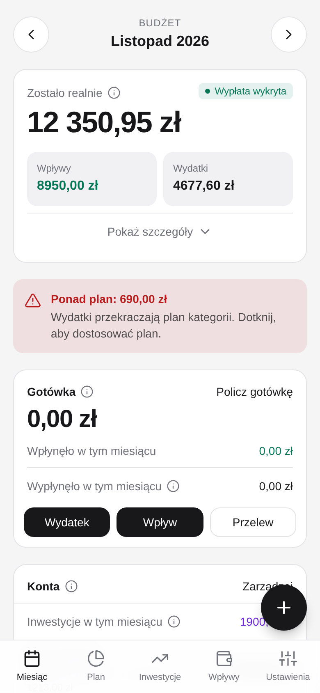
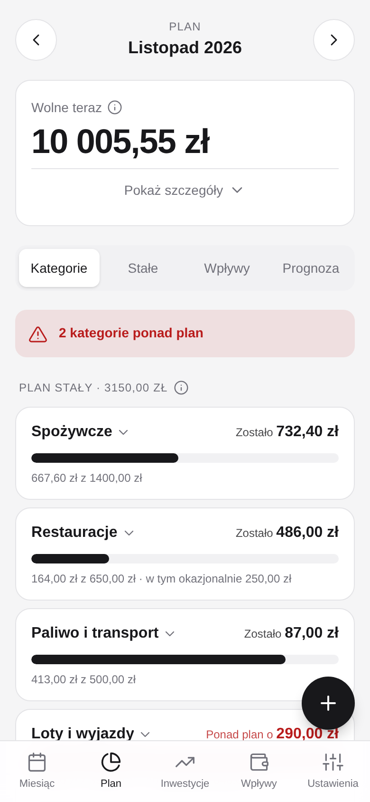
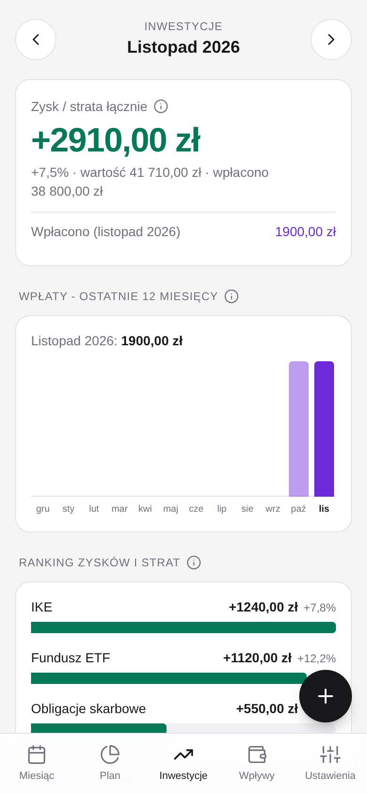
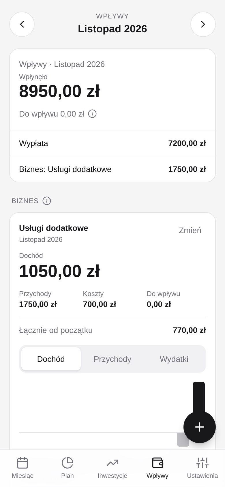
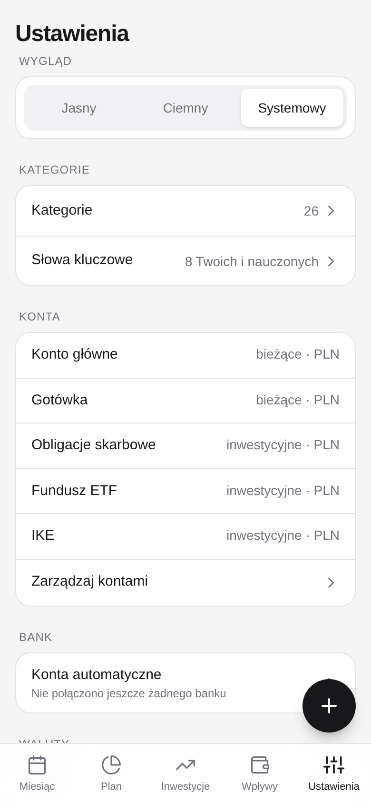
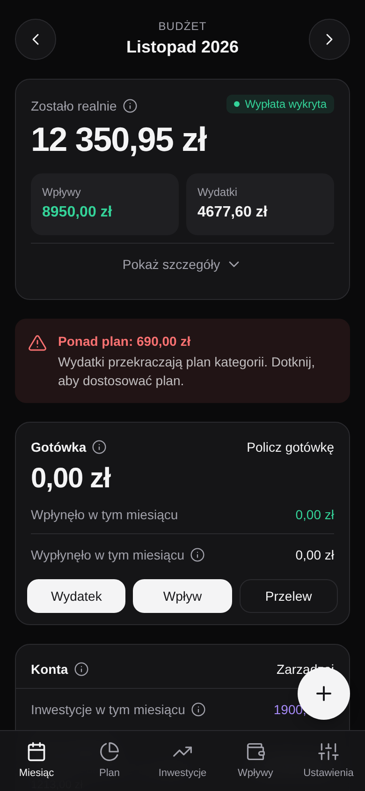
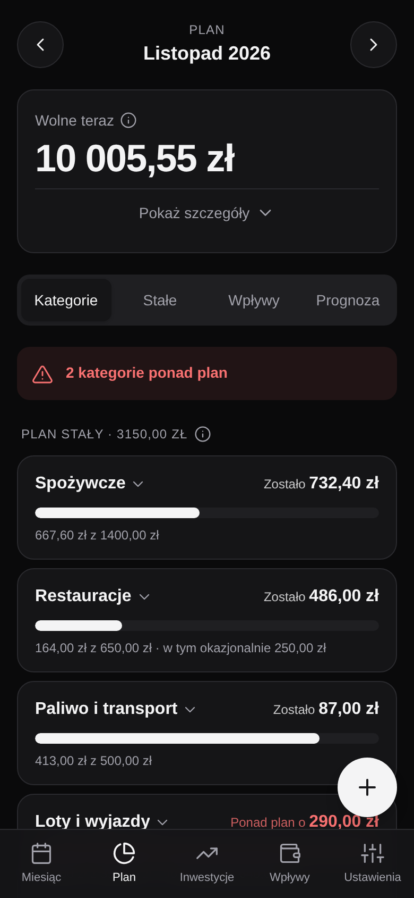
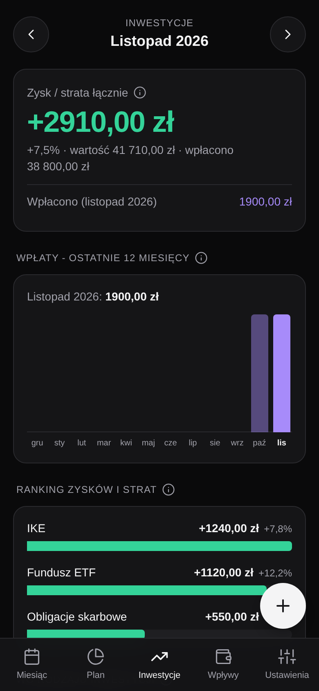
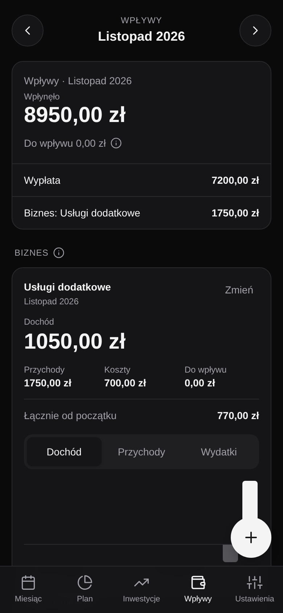
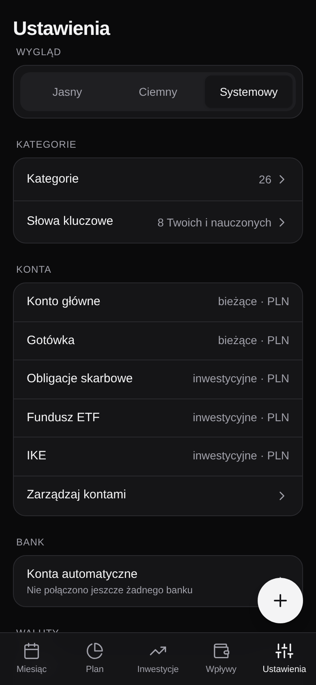

# Budżet - personal budgeting app (showcase)

> Polski opis: [README.pl.md](README.pl.md)

A private household budget app for one person: an **iPhone-first PWA** backed by a **FastAPI + PostgreSQL** API running on a home server, reachable only over a private Tailscale network. I built it to replace a years-old spreadsheet, so every calculation has to match the sheet to the grosz.

This repository is a **showcase only** (screenshots, a demo video and an overview). All data on the screenshots is made up.

[Full demo video (MP4)](media/demo.mp4)

## Screens

| Month | Plan | Investments | Income | Settings |
|---|---|---|---|---|
|  |  |  |  |  |

Dark theme follows the system setting:

| Month | Plan | Investments | Income | Settings |
|---|---|---|---|---|
|  |  |  |  |  |

The UI is in Polish.

## What it does

- **Month view** - "left for real" balance: income, paid and unpaid expenses, planned spending and investments, and a month-end forecast, all computed by the backend.
- **Payday-driven budgeting** - a detected salary payment starts the budget month, generates recurring bills and rolls the balance forward.
- **Plans** - fixed plan per category (from a month onward), one-off plans for a single month, income plan, investment plan (fixed amount or percent of salary) and a 12-month forecast.
- **Investments** - accounts with manual valuations, profit/loss ranking, deposits per month and an asset-class breakdown, so growth is never confused with deposits.
- **Side business card** - income, costs and profit per month with a running total.
- **Bank sync (PSD2)** - transactions pulled in the background through an open-banking aggregator; the bank account becomes the source of truth. Card holds can be split and categorised, duplicates are detected, and a single likely match is merged automatically.
- **Smart categories** - suggestions from rules and keywords, learning only from the user's own choices.
- **Safe by design** - confirmation before every manual entry, duplicate detection, a toast that says exactly what changed ("what: from X to Y"), automatic database backup before every migration plus weekly offsite backups.

## Tech stack

| Layer | Technology |
|---|---|
| Frontend | React 19, TypeScript, Vite, Tailwind CSS 4, TanStack Query |
| Backend | Python, FastAPI, Pydantic, psycopg 3 (plain SQL) |
| Database | PostgreSQL 16, 48 versioned SQL migrations |
| Infra | Docker Compose (db, api, nginx web), Tailscale HTTPS, deploy script with pre-migration backups |
| Quality | pytest suite with a fresh database copy per test, randomized property-style tests with invariants (accounts sum, app balance = bank balance), ruff, Prettier |

## Engineering notes

- **Rules live in the backend** (`budget.py`); the frontend only displays. A single place for money logic keeps the app consistent with the original spreadsheet.
- **Invariant-driven testing** - random sequences of API operations are checked against accounting invariants and "no 5xx" rules, in addition to hand-written scenario tests per business rule.
- **Migrations, never edits** - every schema change is a numbered SQL migration; data must survive each one.
- **Built with an AI pair-programmer** - a planner/executor/reviewer workflow with project skills that record the domain rules, so rules are documented once and enforced by tests.

## About this repository

The application source code is kept in a separate repository. Screenshots and video were generated automatically against a throwaway test database with neutral demo data, using a Playwright script.
