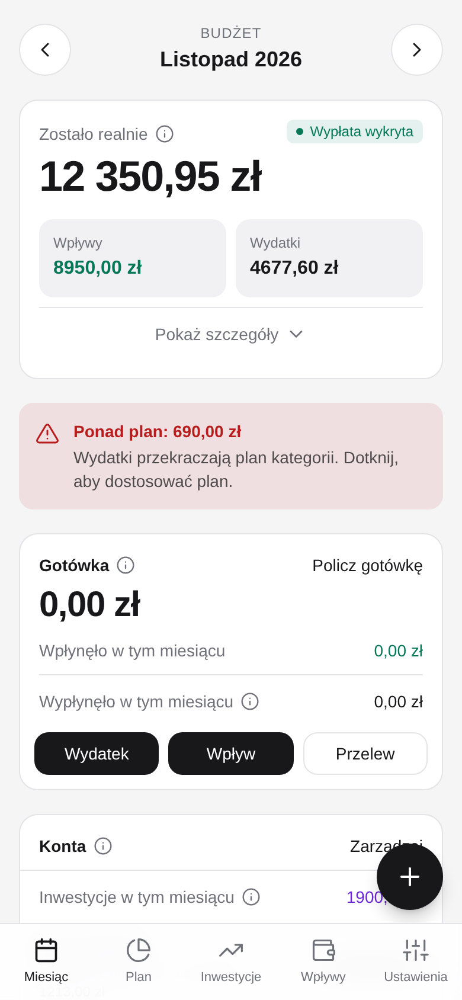
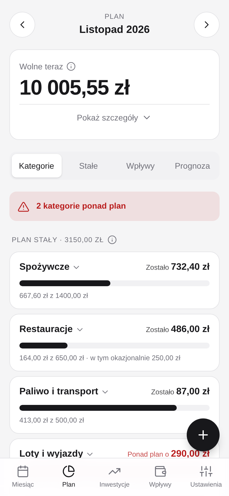
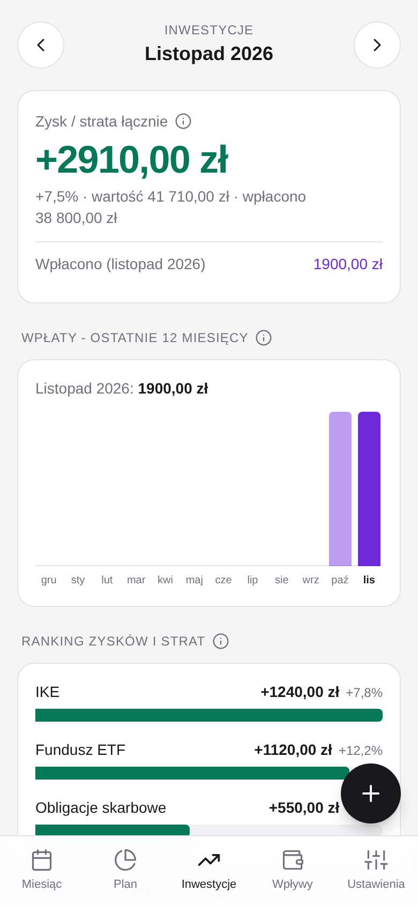
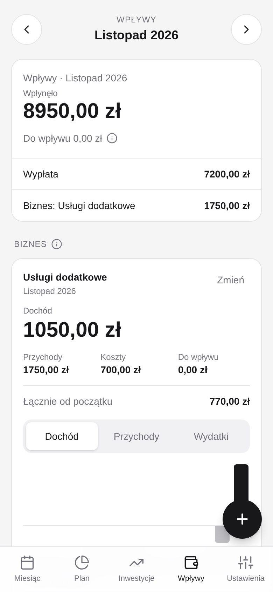
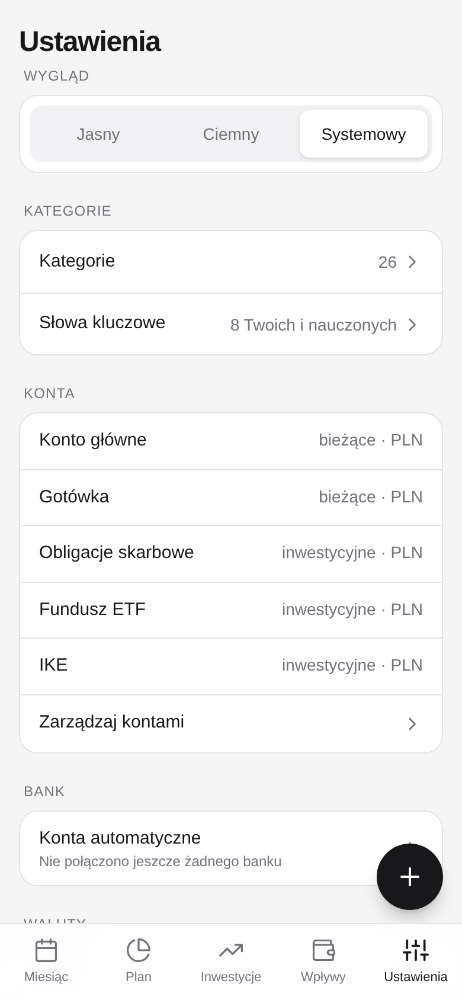
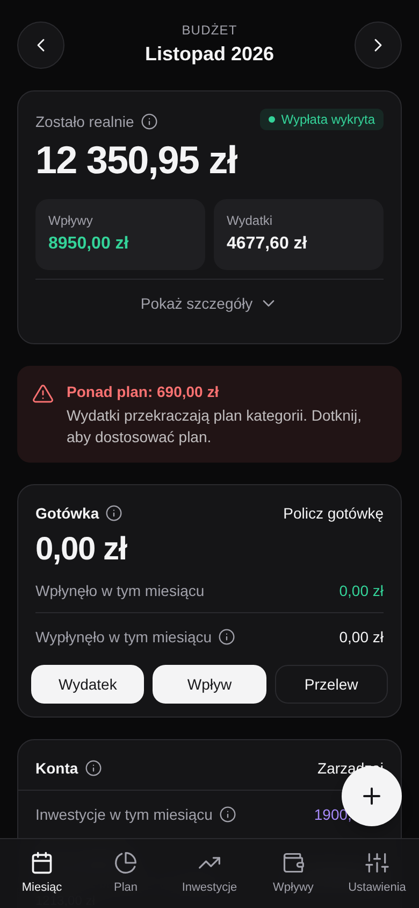
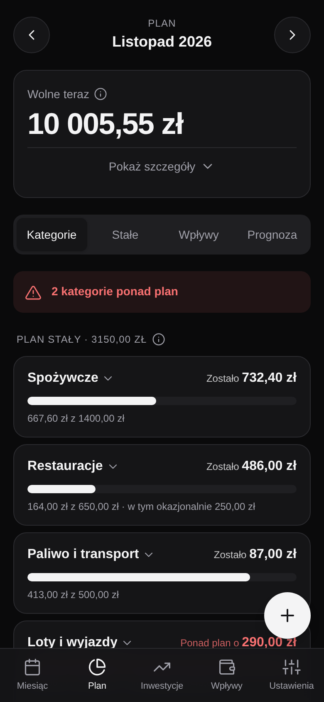
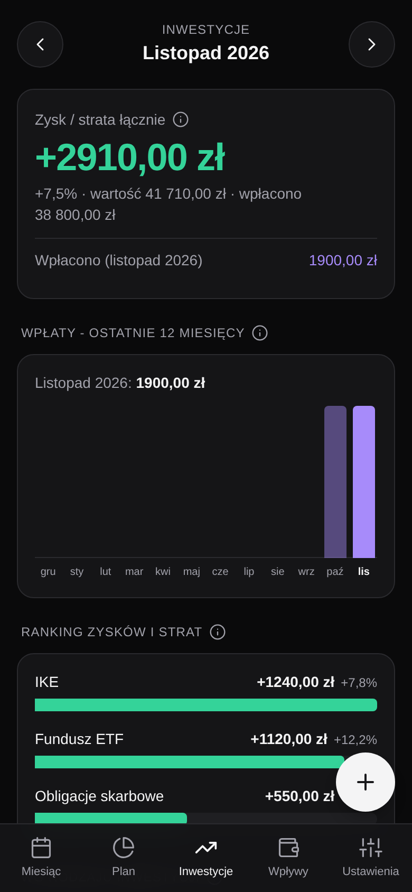
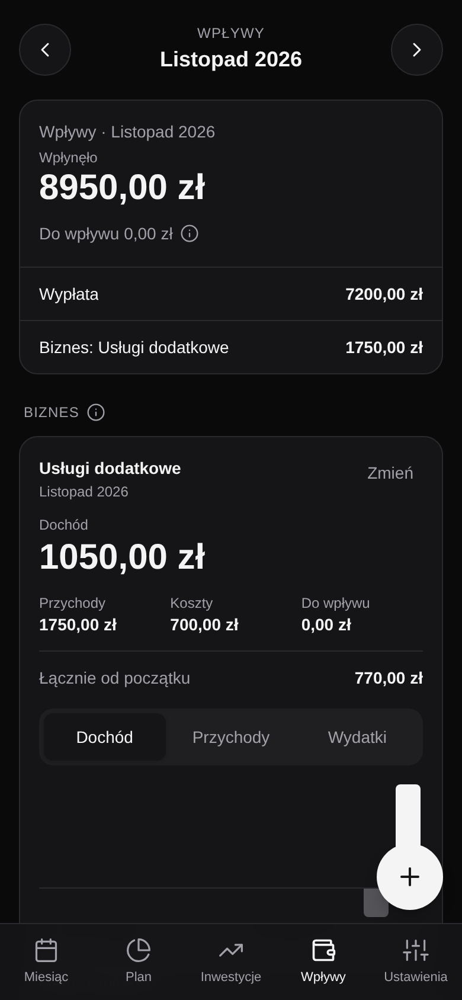
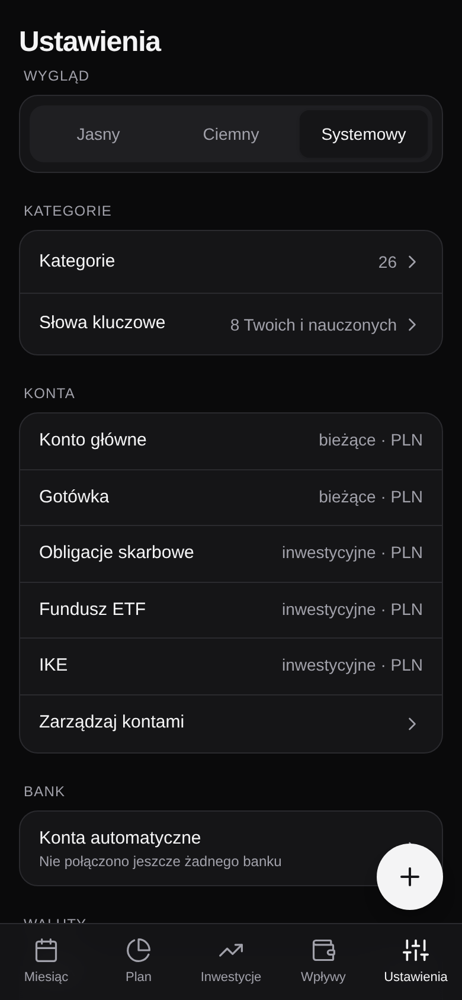

# Budżet - osobista aplikacja budżetowa (showcase)

> English version: [README.md](README.md)

Prywatna aplikacja do budżetu domowego dla jednej osoby: **PWA na iPhone'a** z **API w FastAPI + PostgreSQL** na serwerze domowym, dostępnym tylko przez prywatną sieć Tailscale. Powstała w miejsce wieloletniego arkusza kalkulacyjnego, więc wyliczenia muszą się zgadzać z arkuszem co do grosza.

To repozytorium to **sam showcase** (zrzuty ekranu, wideo i opis). Wszystkie dane na zrzutach są wymyślone.

[Pełne wideo (MP4)](media/demo.mp4)

## Ekrany

| Miesiąc | Plan | Inwestycje | Wpływy | Ustawienia |
|---|---|---|---|---|
|  |  |  |  |  |

Motyw ciemny (zgodnie z ustawieniem systemu):

| Miesiąc | Plan | Inwestycje | Wpływy | Ustawienia |
|---|---|---|---|---|
|  |  |  |  |  |

## Co potrafi

- **Widok miesiąca** - „zostało realnie”: wpływy, opłacone i do zapłaty, planowane wydatki i inwestycje oraz prognoza na koniec miesiąca, liczone w całości przez backend.
- **Budżet liczony od wypłaty** - wykryta wypłata zaczyna miesiąc budżetowy, generuje stałe opłaty i przenosi saldo.
- **Plany** - plan stały kategorii (od miesiąca w przód), okazjonalny (tylko jeden miesiąc), plan wpływów, plan inwestycji (kwota albo procent wypłaty) i prognoza na 12 miesięcy.
- **Inwestycje** - konta z ręcznymi wycenami, ranking zysków i strat, wpłaty miesięczne i podział na rodzaje; wzrost nigdy nie myli się z wpłatą.
- **Karta biznesu** - przychody, koszty i dochód miesięczny z sumą narastającą.
- **Bank (PSD2)** - transakcje pobierane w tle przez agregatora open banking; konto z bankiem staje się źródłem prawdy. Blokady kartowe można dzielić i kategoryzować, duplikaty są wykrywane, a jeden pasujący kandydat łączy się sam.
- **Inteligentne kategorie** - podpowiedzi z reguł i słów kluczowych, uczenie wyłącznie z wyborów użytkownika.
- **Bezpieczeństwo danych** - potwierdzenie przed każdym wpisem ręcznym, wykrywanie duplikatów, komunikat „co: z czego na co” po każdej zmianie, kopia bazy przed każdą migracją i tygodniowa kopia poza serwerem.

## Technologie

| Warstwa | Technologia |
|---|---|
| Frontend | React 19, TypeScript, Vite, Tailwind CSS 4, TanStack Query |
| Backend | Python, FastAPI, Pydantic, psycopg 3 (czysty SQL) |
| Baza | PostgreSQL 16, 48 wersjonowanych migracji SQL |
| Infrastruktura | Docker Compose (db, api, nginx), HTTPS przez Tailscale, skrypt wdrożeniowy z kopią przed migracją |
| Jakość | pytest ze świeżą kopią bazy na każdy test, testy losowe z niezmiennikami (suma kont, saldo aplikacji = saldo banku), ruff, Prettier |

## Uwagi inżynierskie

- **Reguły w backendzie** (`budget.py`), frontend tylko wyświetla - jedno miejsce z logiką pieniędzy trzyma aplikację spójną z arkuszem.
- **Testy z niezmiennikami** - losowe sekwencje operacji API sprawdzane pod kątem reguł księgowych i braku błędów 5xx, obok testów scenariuszowych każdej reguły biznesowej.
- **Migracje, nigdy edycje** - każda zmiana schematu to numerowana migracja SQL; dane muszą ją przetrwać.
- **Praca z asystentem AI** - podział planista / wykonawca / recenzent oraz skille opisujące reguły domeny, więc każda reguła jest opisana raz i pilnowana testami.

## O tym repozytorium

Kod aplikacji jest w osobnym repozytorium. Zrzuty i wideo wygenerował automatycznie skrypt Playwright na tymczasowej bazie testowej z neutralnymi danymi demo.
